**Aluno:** Saulo José Almeida Silva  
**Tema de Pesquisa:** Coordenação de sistemas de múltiplos robôs (MRS) heterogêneos no Continuum Físico-Cibernético.  
**Disciplina:** Redes de Comunicação de Sistemas Físicos Cibernéticos (UFCG)  
**Professor:** Dr. Danilo Freire de Souza Santos  
**Data do documento no slide:** 3 de novembro de 2026  
**Data de Congelamento do Protocolo:** Outubro de 2026

---

## Observações do professor

1. Diminuir a taxonomia, está com muitos níveis.
2. Atualizar as strings de busca com base nisso.
3. Procurar nas bases de dados quantos artigos retornam e algumas soluções.

> Observação: o slide já reflete a taxonomia reduzida para **3 níveis** e as strings **S1–S3**. A tabela de resultados brutos das buscas (seção 10), o funil de seleção (seção 12) e o perfil quantitativo da base e do Top 50 (seções 12.5 a 12.9) estão preenchidos neste documento.

---

**Atividades anteriores:** 
![[Project_RC___Part_4 1.pdf]]

---

# PARTE I — PROTOCOLO (Planejamento)

## 1. Descrição da Atividade e Propósito

Esta RSL é classificada como um **mapeamento amplo e de caracterização**. O estudo busca entender como sistemas de múltiplos robôs (MRS) heterogêneos são concebidos, comunicados, integrados e executados ao longo do Continuum Físico-Cibernético. O objetivo final é obter uma visão do estado da arte e das soluções em uso, e propor arquiteturas de referência para o continuum físico-cibernético em MRS.

Por ser a atividade de uma disciplina, com prazo até dezembro de 2026, o protocolo adota um desenho **enxuto**: amostra final de no máximo **40 estudos** e avaliação de qualidade simplificada (seção 14).

> [!warning] Desvio em relação ao protocolo congelado Na execução, o teto da amostra para síntese aprofundada foi elevado de **40 para 50 estudos**, e a ordenação por citações foi substituída por um **ranking multicritério automatizado** (seção 12.5). Os demais trechos do protocolo (seções 1, 5.2, 12.1–12.4, 13 e 17) mantêm o texto original de 40 estudos e devem ser harmonizados com este desvio antes da entrega final.

### 1.1 Princípios da Busca e da Extração

- **Busca Generalista:** as strings de busca usam conceitos genéricos do domínio (MRS, edge computing, digital twin, latency, QoS). Isso maximiza a cobertura e reduz o viés de amostragem; a seleção fina ocorre nos critérios CI/CE.
- **Extração Indutiva:** tecnologias, middlewares, protocolos e algoritmos são descobertos na extração. O objetivo é mapear o ecossistema real (ROS 2, DDS, Zenoh, 5G, TSN, controle distribuído).

### 1.2 Estrutura PCC (Population, Concept, Context)

|Elemento|Definição no Protocolo|
|:--|:--|
|**P (População)**|Sistemas de múltiplos robôs (≥ 2 agentes), homogêneos ou heterogêneos.|
|**C (Conceito)**|Elementos do continuum: comunicação, integração ciber-física e infraestrutura distribuída.|
|**C (Contexto)**|Qualquer classe de missão/tarefa em ambientes estáticos ou dinâmicos.|

---

## 2. Objetivos

1. Caracterizar o Continuum Físico-Cibernético em **3 Níveis Fundamentais** e suas ramificações operacionais.
2. Catalogar o ecossistema tecnológico e middlewares emergentes em cada dimensão.
3. Propor **2 Arquiteturas de Referência** do Continuum Padrão para MRS.
4. Mapear lacunas da literatura para oportunidades futuras de pesquisa.

---

## 3. Perguntas de Pesquisa (RQs)

- **RQ1 (Panorama e Tecnologias):** Quais tecnologias, middlewares e protocolos de rede sustentam a integração ciber-física em MRS no continuum?
- **RQ2 (Arquiteturas de Referência):** Como a infraestrutura Continuum (Robô–Edge–Fog–Cloud) é organizada para distribuir controle e processamento em tempo real?
- **RQ3 (Comunicação e Redes):** Quais modos de comunicação, topologias e mecanismos de QoS são empregados para mitigar latência e perdas?
- **RQ4 (Coordenação e Controle na Frota):** Quais paradigmas de coordenação, alocação de tarefas e técnicas de inteligência são aplicados à frota?
- **RQ5 (Taxonomia e Lacunas):** Como as soluções existentes se distribuem nas 3 dimensões da taxonomia e quais lacunas permanecem abertas?

---

## 4. Caracterização dos 3 Níveis da Taxonomia

|Nível / Eixo|Ramificação / Sub-dimensão|Palavras-chave núcleo|Variantes e termos relacionados|
|:--|:--|:--|:--|
|**1. Frota Robótica**|Agentes, Heterogeneidade, Escala, Coordenação & Tarefas|multi-robot, robot team, robot fleet, robot swarm, heterogeneous robots|multirobot, swarm robotics, heterogeneous multi-robot, coordination, task allocation|
|**2. Comunicação & Redes**|Topologias, Modos de Troca, Métricas de Desempenho & Protocolos|communication, network, latency, packet loss, bandwidth, quality of service|wireless, delay, connectivity, QoS, real-time network, TSN, 5G|
|**3. Integração Físico-Cibernética**|Infraestrutura Continuum, Gêmeos Digitais, HIL & Sincronização|cyber-physical, digital twin, computing continuum, edge computing, cloud robotics|cyber physical, hardware in the loop, HIL, fog robotics, co-simulation, real-time sync|

### 4.1 Diagrama da Taxonomia Hierárquica (3 Níveis Iniciais)

**Taxonomia da Coordenação de MRS no Continuum Físico-Cibernético**  
_Estrutura em 3 Níveis Iniciais e suas Ramificações de Análise_

#### Nível 1: Frota Robótica — Agentes, Decisão & Ambiente

- **Heterogeneidade & Tipologia:** UAVs, UGVs, USVs; Escala de Frota.
- **Coordenação & Decisão:** Paradigmas Central./Descentral. e Algoritmos.
- **Ambiente & Restrições:** Dinamismo, Cobertura, Missões & Tarefas.

#### Nível 2: Comunicação & Redes — Topologias, QoS & Protocolos

- **Modos & Topologias:** Comunicação Explícita/Implícita, Mesh, P2P.
- **Requisitos de Desempenho:** Latência, Perda de Pacotes, Banda, QoS.
- **Tecnologias & Redes:** Wi-Fi, 5G/6G, TSN, Protocolos de Troca.

#### Nível 3: Integração Físico-Cibernética — Continuum, Gêmeos Digitais & HIL

- **Infraestrutura Continuum:** Camadas Robô–Edge–Fog–Cloud & Offloading.
- **Gêmeos Digitais & HIL:** Co-Simulação, Espaçamento & Bancadas.
- **Sincronização & Middleware:** Sincronização T.R., ROS 2, DDS, Zenoh.

### 4.2 Estrutura Tridimensional → Síntese das Evidências

Os **3 níveis principais** orientam a formulação das _strings_ e a categorização primária. Suas **ramificações** permitem capturar detalhadamente as tecnologias, middlewares e algoritmos emergentes extraídos dos estudos.

---

## 5. Caracterização Metodológica e Escopo

### 5.1 Classificação Metodológica

- **Natureza:** Aplicada.
- **Abordagem:** Quali-quantitativa.
- **Objetivo:** Exploratória e Descritiva.
- **Método:** RSL via protocolo Kitchenham e diretrizes PRISMA 2020.

### 5.2 Bases de Dados & Recorte

- **Janela Temporal:** 2020 – 2026.
- **Bases Selecionadas:**
    1. Scopus (Base principal/calibração)
    2. IEEE Xplore
    3. Web of Science
- **Limitações declaradas:**
    - SpringerLink foi excluída por oferecer busca avançada com restrição limitada de campos e varredura de texto completo, o que gera ruído e compromete a reprodutibilidade.
    - Avaliação de qualidade simplificada (3 itens, um único revisor) e amostra limitada a no máximo 40 estudos, devido ao escopo e ao prazo da disciplina. Não há avaliação formal de risco de viés.
    - A seleção pelos mais citados tende a favorecer artigos mais antigos (seção 12).

---

## 6. Critérios de Elegibilidade (CI e CE)

### 6.1 Critérios de Inclusão (CI)

- **CI1:** Sistemas de múltiplos robôs (≥ 2).
- **CI2:** Aborda ao menos uma ramificação das dimensões de Comunicação (N2) ou Integração Físico-Cibernética (N3).
- **CI3:** Descrição clara de arquitetura, protocolo, middleware ou modelo do sistema.
- **CI4:** Artigo em periódico ou conferência revisado por pares (Inglês).
- **CI5:** Publicado entre 2020 e 2026.

### 6.2 Critérios de Exclusão (CE)

- **CE1:** Robô único (single-agent).
- **CE2:** Estudo sobre MRS sem nenhum elemento de rede/comunicação ou integração ciber-física.
- **CE3:** Resumos estendidos (< 4 págs), editoriais, tutoriais e posters.
- **CE4:** Texto completo inacessível.
- **CE5:** Fora do domínio de robótica e engenharia.

---

## 7. Roadmap e Cronograma Executivo (8 Semanas, até dezembro de 2026)

### Planejamento em 4 Fases (Protocolo PRISMA)

|Fase|Semanas|Atividade|
|:-:|:-:|:--|
|**1**|Sem 1–2|Planejamento — Plano & Congelamento|
|**2**|Sem 3–4|Execução — Buscas & Triagem PRISMA|
|**3**|Sem 5–6|Análise — Elegibilidade & Extração (com QA1–QA3)|
|**4**|Sem 7–8|Consolidação — Taxonomia & Arquiteturas|

### Cronograma enxuto para o restante do prazo

|Período|Atividade|
|:--|:--|
|Semana 1 (até 13/11)|Deduplicação e seleção dos 200 mais citados|
|Semanas 2–3|Triagem por título/resumo e leitura completa até 40 estudos|
|Semanas 3–4|Extração e QA1–QA3 (feitos juntos, na mesma leitura)|
|Semanas 5–6|Síntese, taxonomia e 2 arquiteturas de referência|
|Semanas 7–8|Redação do relatório e fechamento|

---

# PARTE II — EXECUÇÃO (Fluxo de Pesquisa)

## 8. Visão Geral do Fluxo

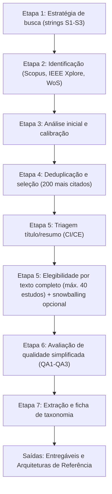

|Etapa|O que acontece|Seção|
|:-:|:--|:-:|
|**1**|Montagem e documentação das strings por base|9|
|**2**|Execução das buscas e contagem bruta por string e base|10|
|**3**|Reflexão sobre sensibilidade, especificidade e ajustes|11|
|**4**|Deduplicação (Zotero + Rayyan) e seleção dos 200 mais citados|12|
|**5**|Triagem por título/resumo e elegibilidade por texto completo, até no máximo 40 estudos (fluxo PRISMA)|13|
|**6**|Pontuação simples de qualidade (3 itens)|14|
|**7**|Extração de dados nos 3 níveis e ficha de taxonomia|15|

---

## 9. Etapa 1 — Estratégia de Busca (Blocos por Dimensão)

### 9.1 Como as strings foram montadas

A construção seguiu seis passos, ligados à estrutura PCC (seção 1.2) e aos 3 níveis da taxonomia (seção 4):

1. **Um grupo de termos por nível.** O Nível 1 (Frota) vira o grupo **N1**; o Nível 2 (Comunicação & Redes) vira **N2**; o Nível 3 (Integração Físico-Cibernética) vira **N3**. Um grupo auxiliar **H** isola a heterogeneidade da frota. Os termos vêm das colunas "Palavras-chave núcleo" e "Variantes" da tabela da seção 4, ampliados com sinônimos encontrados na literatura (por exemplo, `UAV swarm`, `multi-AGV`, `cloud-edge`, `device-edge-cloud`).
2. **N1 em toda string (População do PCC).** Todas as strings exigem N1, o que garante que o estudo trate de múltiplos robôs (CI1). N1 também cobre veículos que a literatura de continuum costuma chamar de UAV ou AGV, sem usar a palavra "robot".
3. **Intersecção com N2 ou N3 (Conceito do PCC).** Combinar N1 com a infraestrutura ou a comunicação reproduz o CI2 e evita recuperar a literatura clássica de MRS sem rede nem continuum, que o CE2 exclui.
4. **Expressões compostas em vez de palavras ambíguas.** Termos soltos como `edge`, `cloud`, `network`, `simulation` e `real-time` foram evitados: `edge` casa com detecção de bordas e arestas de grafo, `cloud` com _point cloud_, `network` com _neural network_. Em seu lugar entram `"edge computing"`, `"cloud robotics"`, `"communication network"`, `"network latency"` e similares. A sigla DDS aparece por extenso (`"data distribution service"`) para evitar ruído de outras áreas.
5. **Variantes escritas por extenso.** Plurais e grafias (`"robot swarm" OR "robot swarms"`, `"hardware-in-the-loop" OR "hardware in the loop"`) são listados explicitamente, sem curingas (`*`) dentro de aspas, porque o tratamento de curingas, hífens e aspas varia entre as bases.
6. **Termos de coordenação ficam fora das strings.** Seguindo a extração indutiva (seção 1.1), paradigmas, algoritmos e técnicas de decisão (RQ4) são descobertos na leitura dos estudos incluídos. Incluí-los na busca restringiria a amostra e traria de volta a literatura de MRS sem continuum.

### 9.2 Grupos de termos

**N1 — Frota Robótica (Nível 1)**

```
("multi-robot" OR "multirobot" OR "multiple robots" OR "robot swarm" OR "robot swarms" OR "swarm robotics" OR "robot fleet" OR "robot fleets" OR "fleet of robots" OR "robot team" OR "robot teams" OR "heterogeneous robots" OR "UAV swarm" OR "UAV swarms" OR "multi-UAV" OR "AGV fleet" OR "AGV fleets" OR "multi-AGV" OR ("multi-agent" AND (robot OR robots OR robotic)))
```

**H — Heterogeneidade (usado somente na S3)**

```
(heterogeneous OR heterogenous OR "UAV-UGV" OR "UGV-UAV" OR "air-ground" OR "aerial-ground" OR "mixed fleet" OR "mixed fleets")
```

**N2 — Comunicação & Redes (Nível 2)**

```
("communication network" OR "communication networks" OR "wireless network" OR "wireless networks" OR "network latency" OR "communication latency" OR "packet loss" OR QoS OR "quality of service" OR "time-sensitive networking" OR TSN OR middleware OR "ROS 2" OR ROS2 OR "data distribution service" OR Zenoh OR MANET OR FANET OR 5G OR 6G OR URLLC OR "delay-tolerant")
```

**N3 — Integração Físico-Cibernética (Nível 3)**

```
("edge computing" OR "fog computing" OR "cloud robotics" OR "fog robotics" OR "mobile edge computing" OR "computation offloading" OR "task offloading" OR "cloud-edge" OR "edge-cloud" OR "computing continuum" OR "device-edge-cloud" OR "cyber-physical continuum" OR "swarm computing" OR "digital twin" OR "digital twins" OR "digital shadow" OR "digital shadows" OR "cyber-physical" OR "hardware-in-the-loop" OR "hardware in the loop" OR "co-simulation")
```

### 9.3 Composição das Strings

|String|Composição|Foco|RQs atendidas|
|:--|:--|:--|:--|
|**S1 — Continuum/CPS**|N1 AND N3|Infraestrutura continuum, gêmeos digitais, HIL|RQ2 (e RQ1)|
|**S2 — Redes/QoS**|N1 AND N2|Comunicação, protocolos, middlewares, QoS|RQ3 (e RQ1)|
|**S3 — Heterogeneidade**|N1 AND H AND (N2 OR N3)|Frotas heterogêneas com rede ou continuum|RQ1 a RQ3, com recorte heterogêneo|

RQ4 (coordenação) e RQ5 (taxonomia e lacunas) são respondidas na extração, sobre o conjunto incluído (seção 1.1).

> **Atenção:** a S3 é, por construção, um subconjunto de S1 ∪ S2. Ela não recupera registros novos; serve para medir quanto da literatura trata de frotas heterogêneas e para a calibração. Como a deduplicação ocorre no Zotero, não há prejuízo em mantê-la, mas ela pode ser descartada se a banca preferir menos strings.

### 9.4 Parâmetros por base

|Base|Onde buscar|Campo de busca|Filtros|
|:--|:--|:--|:--|
|Scopus|https://www.scopus.com → Search → Advanced query|`TITLE-ABS-KEY(...)`|`PUBYEAR > 2019 AND PUBYEAR < 2027 AND LANGUAGE(english) AND (DOCTYPE(ar) OR DOCTYPE(cp))` (na própria string)|
|Web of Science|https://www.webofscience.com → Core Collection → Advanced Search|`TS=(...)`|`PY=(2020-2026) AND LA=English AND DT=(Article OR Proceedings Paper)` (na própria string)|
|IEEE Xplore|https://ieeexplore.ieee.org → Advanced Search|3 linhas OR: Document Title, Abstract, Author Keywords|Year 2020–2026; Journals + Conferences (pela interface)|

O acesso ao texto completo é feito pelo Portal CAPES (https://www.periodicos.capes.gov.br) com login CAFe, mas a busca é executada na interface nativa de cada base.

### 9.5 Strings por extenso

**Data da busca:** **06/11/2026**

#### Scopus

**S1**

```
TITLE-ABS-KEY(("multi-robot" OR "multirobot" OR "multiple robots" OR "robot swarm" OR "robot swarms" OR "swarm robotics" OR "robot fleet" OR "robot fleets" OR "fleet of robots" OR "robot team" OR "robot teams" OR "heterogeneous robots" OR "UAV swarm" OR "UAV swarms" OR "multi-UAV" OR "AGV fleet" OR "AGV fleets" OR "multi-AGV" OR ("multi-agent" AND (robot OR robots OR robotic))) AND ("edge computing" OR "fog computing" OR "cloud robotics" OR "fog robotics" OR "mobile edge computing" OR "computation offloading" OR "task offloading" OR "cloud-edge" OR "edge-cloud" OR "computing continuum" OR "device-edge-cloud" OR "cyber-physical continuum" OR "swarm computing" OR "digital twin" OR "digital twins" OR "digital shadow" OR "digital shadows" OR "cyber-physical" OR "hardware-in-the-loop" OR "hardware in the loop" OR "co-simulation")) AND PUBYEAR > 2019 AND PUBYEAR < 2027 AND LANGUAGE(english) AND (DOCTYPE(ar) OR DOCTYPE(cp))
```

**S2**

```
TITLE-ABS-KEY(("multi-robot" OR "multirobot" OR "multiple robots" OR "robot swarm" OR "robot swarms" OR "swarm robotics" OR "robot fleet" OR "robot fleets" OR "fleet of robots" OR "robot team" OR "robot teams" OR "heterogeneous robots" OR "UAV swarm" OR "UAV swarms" OR "multi-UAV" OR "AGV fleet" OR "AGV fleets" OR "multi-AGV" OR ("multi-agent" AND (robot OR robots OR robotic))) AND ("communication network" OR "communication networks" OR "wireless network" OR "wireless networks" OR "network latency" OR "communication latency" OR "packet loss" OR QoS OR "quality of service" OR "time-sensitive networking" OR TSN OR middleware OR "ROS 2" OR ROS2 OR "data distribution service" OR Zenoh OR MANET OR FANET OR 5G OR 6G OR URLLC OR "delay-tolerant")) AND PUBYEAR > 2019 AND PUBYEAR < 2027 AND LANGUAGE(english) AND (DOCTYPE(ar) OR DOCTYPE(cp))
```

**S3**

```
TITLE-ABS-KEY(("multi-robot" OR "multirobot" OR "multiple robots" OR "robot swarm" OR "robot swarms" OR "swarm robotics" OR "robot fleet" OR "robot fleets" OR "fleet of robots" OR "robot team" OR "robot teams" OR "heterogeneous robots" OR "UAV swarm" OR "UAV swarms" OR "multi-UAV" OR "AGV fleet" OR "AGV fleets" OR "multi-AGV" OR ("multi-agent" AND (robot OR robots OR robotic))) AND (heterogeneous OR heterogenous OR "UAV-UGV" OR "UGV-UAV" OR "air-ground" OR "aerial-ground" OR "mixed fleet" OR "mixed fleets") AND (("communication network" OR "communication networks" OR "wireless network" OR "wireless networks" OR "network latency" OR "communication latency" OR "packet loss" OR QoS OR "quality of service" OR "time-sensitive networking" OR TSN OR middleware OR "ROS 2" OR ROS2 OR "data distribution service" OR Zenoh OR MANET OR FANET OR 5G OR 6G OR URLLC OR "delay-tolerant") OR ("edge computing" OR "fog computing" OR "cloud robotics" OR "fog robotics" OR "mobile edge computing" OR "computation offloading" OR "task offloading" OR "cloud-edge" OR "edge-cloud" OR "computing continuum" OR "device-edge-cloud" OR "cyber-physical continuum" OR "swarm computing" OR "digital twin" OR "digital twins" OR "digital shadow" OR "digital shadows" OR "cyber-physical" OR "hardware-in-the-loop" OR "hardware in the loop" OR "co-simulation"))) AND PUBYEAR > 2019 AND PUBYEAR < 2027 AND LANGUAGE(english) AND (DOCTYPE(ar) OR DOCTYPE(cp))
```

#### Web of Science (Core Collection)

**S1**

```
TS=(("multi-robot" OR "multirobot" OR "multiple robots" OR "robot swarm" OR "robot swarms" OR "swarm robotics" OR "robot fleet" OR "robot fleets" OR "fleet of robots" OR "robot team" OR "robot teams" OR "heterogeneous robots" OR "UAV swarm" OR "UAV swarms" OR "multi-UAV" OR "AGV fleet" OR "AGV fleets" OR "multi-AGV" OR ("multi-agent" AND (robot OR robots OR robotic))) AND ("edge computing" OR "fog computing" OR "cloud robotics" OR "fog robotics" OR "mobile edge computing" OR "computation offloading" OR "task offloading" OR "cloud-edge" OR "edge-cloud" OR "computing continuum" OR "device-edge-cloud" OR "cyber-physical continuum" OR "swarm computing" OR "digital twin" OR "digital twins" OR "digital shadow" OR "digital shadows" OR "cyber-physical" OR "hardware-in-the-loop" OR "hardware in the loop" OR "co-simulation")) AND PY=(2020-2026) AND LA=English AND DT=(Article OR Proceedings Paper)
```

**S2**

```
TS=(("multi-robot" OR "multirobot" OR "multiple robots" OR "robot swarm" OR "robot swarms" OR "swarm robotics" OR "robot fleet" OR "robot fleets" OR "fleet of robots" OR "robot team" OR "robot teams" OR "heterogeneous robots" OR "UAV swarm" OR "UAV swarms" OR "multi-UAV" OR "AGV fleet" OR "AGV fleets" OR "multi-AGV" OR ("multi-agent" AND (robot OR robots OR robotic))) AND ("communication network" OR "communication networks" OR "wireless network" OR "wireless networks" OR "network latency" OR "communication latency" OR "packet loss" OR QoS OR "quality of service" OR "time-sensitive networking" OR TSN OR middleware OR "ROS 2" OR ROS2 OR "data distribution service" OR Zenoh OR MANET OR FANET OR 5G OR 6G OR URLLC OR "delay-tolerant")) AND PY=(2020-2026) AND LA=English AND DT=(Article OR Proceedings Paper)
```

**S3**

```
TS=(("multi-robot" OR "multirobot" OR "multiple robots" OR "robot swarm" OR "robot swarms" OR "swarm robotics" OR "robot fleet" OR "robot fleets" OR "fleet of robots" OR "robot team" OR "robot teams" OR "heterogeneous robots" OR "UAV swarm" OR "UAV swarms" OR "multi-UAV" OR "AGV fleet" OR "AGV fleets" OR "multi-AGV" OR ("multi-agent" AND (robot OR robots OR robotic))) AND (heterogeneous OR heterogenous OR "UAV-UGV" OR "UGV-UAV" OR "air-ground" OR "aerial-ground" OR "mixed fleet" OR "mixed fleets") AND (("communication network" OR "communication networks" OR "wireless network" OR "wireless networks" OR "network latency" OR "communication latency" OR "packet loss" OR QoS OR "quality of service" OR "time-sensitive networking" OR TSN OR middleware OR "ROS 2" OR ROS2 OR "data distribution service" OR Zenoh OR MANET OR FANET OR 5G OR 6G OR URLLC OR "delay-tolerant") OR ("edge computing" OR "fog computing" OR "cloud robotics" OR "fog robotics" OR "mobile edge computing" OR "computation offloading" OR "task offloading" OR "cloud-edge" OR "edge-cloud" OR "computing continuum" OR "device-edge-cloud" OR "cyber-physical continuum" OR "swarm computing" OR "digital twin" OR "digital twins" OR "digital shadow" OR "digital shadows" OR "cyber-physical" OR "hardware-in-the-loop" OR "hardware in the loop" OR "co-simulation"))) AND PY=(2020-2026) AND LA=English AND DT=(Article OR Proceedings Paper)
```

#### IEEE Xplore

Use o mesmo texto nas três linhas de campo (Title, Abstract, Keywords) ligadas por OR, e aplique os filtros pela interface. Se a interface rejeitar a string por tamanho, divida o grupo N1 em duas metades, rode duas buscas e registre ambas.

**S1**

```
("multi-robot" OR "multirobot" OR "multiple robots" OR "robot swarm" OR "robot swarms" OR "swarm robotics" OR "robot fleet" OR "robot fleets" OR "fleet of robots" OR "robot team" OR "robot teams" OR "heterogeneous robots" OR "UAV swarm" OR "UAV swarms" OR "multi-UAV" OR "AGV fleet" OR "AGV fleets" OR "multi-AGV" OR ("multi-agent" AND (robot OR robots OR robotic))) AND ("edge computing" OR "fog computing" OR "cloud robotics" OR "fog robotics" OR "mobile edge computing" OR "computation offloading" OR "task offloading" OR "cloud-edge" OR "edge-cloud" OR "computing continuum" OR "device-edge-cloud" OR "cyber-physical continuum" OR "swarm computing" OR "digital twin" OR "digital twins" OR "digital shadow" OR "digital shadows" OR "cyber-physical" OR "hardware-in-the-loop" OR "hardware in the loop" OR "co-simulation")
```

**S2**

```
("multi-robot" OR "multirobot" OR "multiple robots" OR "robot swarm" OR "robot swarms" OR "swarm robotics" OR "robot fleet" OR "robot fleets" OR "fleet of robots" OR "robot team" OR "robot teams" OR "heterogeneous robots" OR "UAV swarm" OR "UAV swarms" OR "multi-UAV" OR "AGV fleet" OR "AGV fleets" OR "multi-AGV" OR ("multi-agent" AND (robot OR robots OR robotic))) AND ("communication network" OR "communication networks" OR "wireless network" OR "wireless networks" OR "network latency" OR "communication latency" OR "packet loss" OR QoS OR "quality of service" OR "time-sensitive networking" OR TSN OR middleware OR "ROS 2" OR ROS2 OR "data distribution service" OR Zenoh OR MANET OR FANET OR 5G OR 6G OR URLLC OR "delay-tolerant")
```

**S3**

```
("multi-robot" OR "multirobot" OR "multiple robots" OR "robot swarm" OR "robot swarms" OR "swarm robotics" OR "robot fleet" OR "robot fleets" OR "fleet of robots" OR "robot team" OR "robot teams" OR "heterogeneous robots" OR "UAV swarm" OR "UAV swarms" OR "multi-UAV" OR "AGV fleet" OR "AGV fleets" OR "multi-AGV" OR ("multi-agent" AND (robot OR robots OR robotic))) AND (heterogeneous OR heterogenous OR "UAV-UGV" OR "UGV-UAV" OR "air-ground" OR "aerial-ground" OR "mixed fleet" OR "mixed fleets") AND (("communication network" OR "communication networks" OR "wireless network" OR "wireless networks" OR "network latency" OR "communication latency" OR "packet loss" OR QoS OR "quality of service" OR "time-sensitive networking" OR TSN OR middleware OR "ROS 2" OR ROS2 OR "data distribution service" OR Zenoh OR MANET OR FANET OR 5G OR 6G OR URLLC OR "delay-tolerant") OR ("edge computing" OR "fog computing" OR "cloud robotics" OR "fog robotics" OR "mobile edge computing" OR "computation offloading" OR "task offloading" OR "cloud-edge" OR "edge-cloud" OR "computing continuum" OR "device-edge-cloud" OR "cyber-physical continuum" OR "swarm computing" OR "digital twin" OR "digital twins" OR "digital shadow" OR "digital shadows" OR "cyber-physical" OR "hardware-in-the-loop" OR "hardware in the loop" OR "co-simulation"))
```

---

## 10. Etapa 2 — Identificação: Resultados Brutos das Buscas por Base

**Retornos Brutos por String e Base (data da busca: 06/11/2026)**

|Base de Dados|S1 (Continuum/CPS)|S2 (Redes/QoS)|S3 (Heterog.)|Total identificado|% acesso aberto|
|:--|:-:|:-:|:-:|:-:|:-:|
|Scopus|1687 (541)|1977 (689)|434 (150)|4098 (1380)|33,7%|
|IEEE Xplore|1756 (143)|2210 (199)|469 (40)|4435 (382)|8,6%|
|Web of Science|1235 (495)|1477 (632)|318 (140)|3030 (1267)|41,8%|
|**Total Geral**|4678 (1179)|5664 (1520)|1221 (330)|11563 (3029)|26,2%|

Valores no formato **total (acesso aberto)**. Filtros aplicados na busca: 2020–2026, inglês, artigos de periódico e de conferência. O acesso aberto é um subconjunto do total, não um valor adicional.

### 10.1 Participação por base e por string

|Base|Total|% do total geral|Acesso aberto|% acesso aberto|
|:--|:-:|:-:|:-:|:-:|
|Scopus|4098|35,4%|1380|33,7%|
|IEEE Xplore|4435|38,4%|382|8,6%|
|Web of Science|3030|26,2%|1267|41,8%|
|**Total**|**11563**|**100,0%**|**3029**|**26,2%**|

|String|Total|% do total geral|Acesso aberto|% acesso aberto|
|:--|:-:|:-:|:-:|:-:|
|S1 — Continuum/CPS|4678|40,5%|1179|25,2%|
|S2 — Redes/QoS|5664|49,0%|1520|26,8%|
|S3 — Heterogeneidade|1221|10,6%|330|27,0%|
|**Total**|**11563**|**100,0%**|**3029**|**26,2%**|

> Os percentuais de cada string e de acesso aberto por string foram calculados a partir dos valores da tabela de retornos brutos. Como a S3 é subconjunto de S1 ∪ S2, a soma por string conta registros repetidos entre strings; a deduplicação ocorre na etapa 4.

### 10.2 Gráficos

**Registros identificados por base de dados**

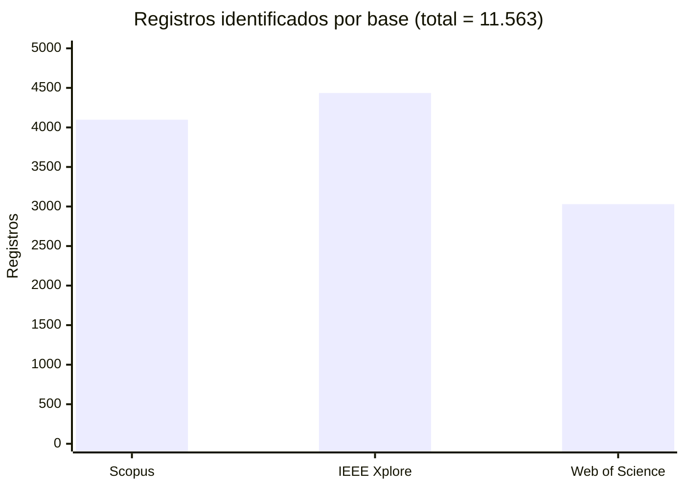

**Registros identificados por string de busca**

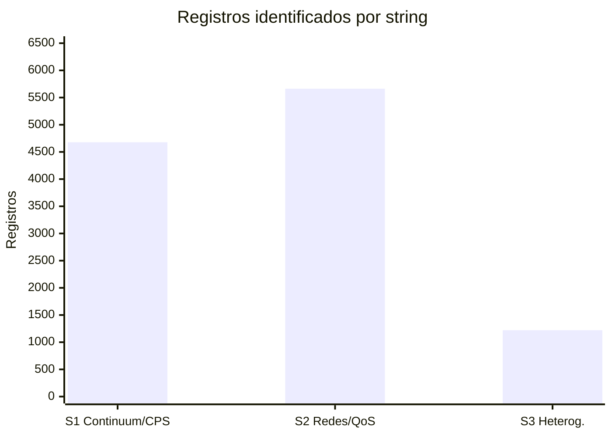

**Percentual de acesso aberto por base**

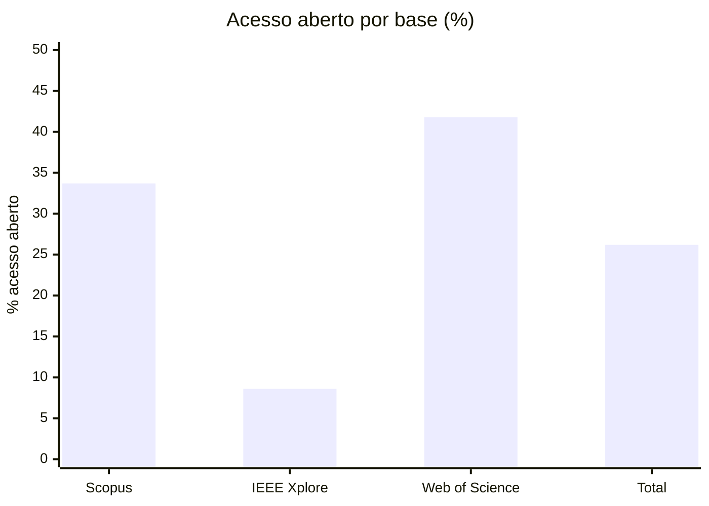

**Participação de cada string no total identificado**

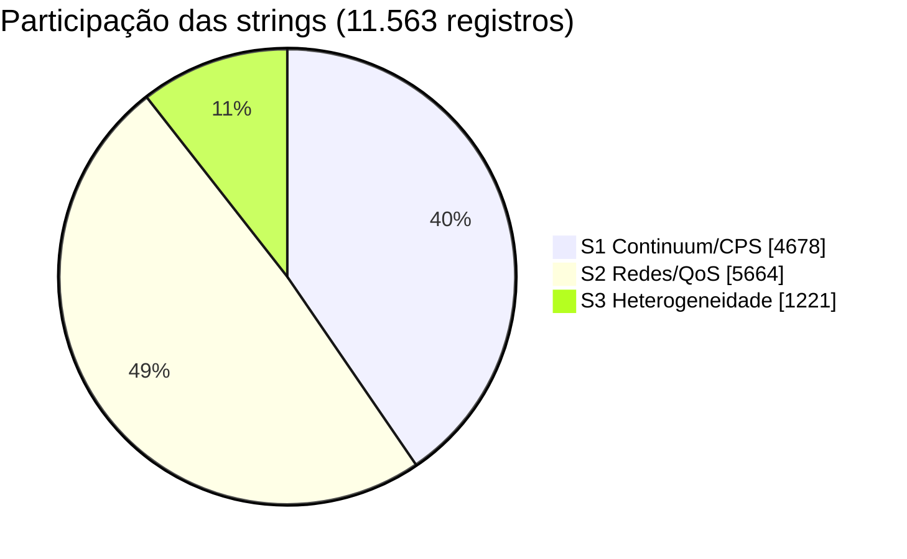

---

## 11. Etapa 3 — Análise Inicial e Reflexões sobre os Resultados de Busca

### Espaço de Reflexão e Anotações da Calibração

- **Sensibilidade e Especificidade das Strings:**  
    As três strings retornaram **11.563 registros** nas três bases, volume alto demais para leitura integral e coerente com a opção por strings generalistas (seção 1.1). A S2 (Redes/QoS) foi a mais abrangente (5.664; 49,0%), seguida da S1 (Continuum/CPS; 4.678; 40,5%). A S3, que acrescenta o filtro de heterogeneidade, reduziu o volume a 1.221 registros (10,6%), como esperado para um subconjunto de S1 ∪ S2. A IEEE Xplore retornou o maior volume (4.435), mas com o menor percentual de acesso aberto (8,6%); a Web of Science teve o maior (41,8%).
    
- **Representatividade por Pilar (Frota vs. Redes vs. CPS):**  
    O pilar de Comunicação & Redes (S2) concentrou o maior volume, seguido de Integração Físico-Cibernética (S1). A heterogeneidade explícita (S3) aparece em cerca de 1 a cada 10 registros, o que indica que frotas heterogêneas são minoria no vocabulário da literatura recuperada. O volume exigiu um funil de redução (seção 12) em vez de triagem manual de todos os registros.
    
- **Ajustes e Decisões Tomadas pós-Piloto:**  
    Decisões registradas na execução: (i) exportação dos 200 registros mais citados por string e por base, incluindo a S3 (≈ 1.800 registros), em vez de apenas S1 e S2 (~600, conforme seção 12.2); (ii) deduplicação no Zotero, resultando em 740 registros únicos; (iii) adoção de ranking multicritério automatizado (seção 12.5) para chegar ao Top 50. [Espaço para registrar eventuais alterações de termos ou operadores por base.]
    

---

## 12. Etapa 4 — Deduplicação, Seleção e Funil de Triagem

**Após deduplicação:** **740 registros únicos** (Zotero).

### 12.1 Justificativa

Devido ao volume (11.563 registros nas 3 bases) e ao prazo de poucas semanas da disciplina, a seleção segue um funil com limites máximos em cada etapa. O objetivo é chegar a, no máximo, **100 candidatos** após todas as filtragens, dos quais serão lidos por completo até **40 estudos**.

### 12.2 Funil de seleção

|Passo|Onde|Previsto no protocolo|Executado|
|:--|:--|:-:|:-:|
|1. Exportar os mais citados de cada base|Scopus, IEEE Xplore, WoS|~600 (S1 e S2)|≈ 1.800 (S1, S2 e S3; 200 por string e base)|
|2. Deduplicar|Zotero|[N]|**740**|
|3. Selecionar os mais citados|Zotero|200|Base de 740 mantida para ranking|
|4. Hard exclusion por CE3 (< 4 págs)|Zotero|—|3 removidos → **737**|
|5. Ranking multicritério (seção 12.5)|Script Python|—|737 pontuados|
|6. Seleção para síntese aprofundada|Zotero|≤ 40|**50**|
|7. Verificação de acesso ao texto completo (CE4)|Portal CAPES|≤ 100|Pendente|

### 12.3 Regras de aplicação

- **Ordenação por citações na exportação:** em cada base, ordenar por número de citações (Scopus: _Cited by (highest)_; WoS: _Times Cited_; IEEE: _Most Cited_) e exportar os ~200 primeiros resultados da S1 e da S2. A S3 é subconjunto de S1 ∪ S2 e não é exportada.
- **Contagem de citações:** como as bases contam citações de formas diferentes, a contagem da Scopus é a referência; para registros que não estiverem nela, usa-se a contagem da própria base.
- **Teto de candidatos:** se mais de 100 estudos passarem na triagem, mantêm-se os 100 mais citados. Se menos de 100 passarem, todos seguem.
- **Acesso ao texto completo:** a busca no Portal CAPES é feita só para os candidatos pós-triagem (≤ 100), e não para os 200. Os inacessíveis são excluídos por CE4 e registrados na tabela PRISMA.
- **Limite de leitura:** os 40 estudos são um teto, não uma meta. A leitura segue a ordem decrescente de citações e é encerrada ao atingir 40 ou ao esgotar o prazo, o que deve ser declarado no relatório.
- **Reserva opcional para estudos recentes:** a ordenação por citações penaliza artigos de 2025–2026. Se desejado, reservar de 5 a 8 das 40 vagas para os estudos elegíveis mais relevantes desses anos.

### 12.4 Limitações desta etapa

- Viés de citação: favorece artigos mais antigos e de grupos mais conhecidos.
- Fontes de citação distintas entre as bases.
- Uso de um único revisor na triagem e na leitura.
- Limite de tempo definindo o encerramento da leitura.

### 12.5 Ranking multicritério automatizado (740 → 50)

Para mitigar o viés de citação apontado na seção 12.4, os 737 candidatos (após o CE3) foram ordenados por um algoritmo em Python que combina relevância semântica, recência e densidade de impacto.

**M1 — Densidade de citações por ano** (neutraliza o viés de idade contra artigos de 2025–2026):

$$\text{Cit}_{\text{year}} = \frac{\text{citações}}{2026 - \text{ano} + 1}$$

**M2 — Relevância semântica TF-IDF:** similaridade de cosseno entre o texto do artigo ($T_i$ = título + resumo + palavras-chave) e o vetor de escopo do RC-SCF ($\vec{S}$):

$$\text{Score}_{\text{TF-IDF}} = \cos(\theta) = \frac{\vec{S} \cdot \vec{T}_i}{|\vec{S}| , |\vec{T}_i|}$$

**M3 — Normalização min-max** das variáveis $X \in {\text{Score}_{\text{TF-IDF}}, \text{ano}, \text{Cit}_{\text{year}}}$ para $[0, 1]$:

$$X_{\text{norm}} = \frac{X - X_{\min}}{X_{\max} - X_{\min}}$$

**Score composto final:**

$$\text{Score}_{\text{final}} = 0{,}45 \cdot \text{Rel}_{\text{norm}} + 0{,}35 \cdot \text{Rec}_{\text{norm}} + 0{,}20 \cdot \text{Cit}_{\text{norm}}$$

|Critério|Peso|
|:--|:-:|
|Relevância ao escopo (TF-IDF)|45%|
|Recência (ano)|35%|
|Citações por ano|20%|

### 12.6 Funil quantitativo (11.563 → 50)

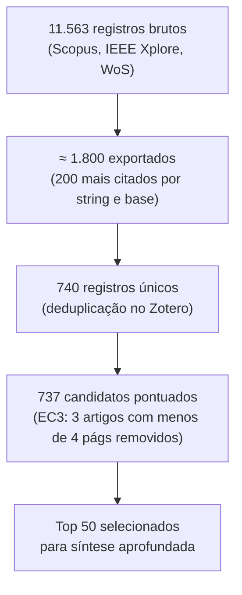

|Etapa|Restantes (N)|Removidos|
|:--|:-:|:-:|
|Registros identificados (Scopus, IEEE Xplore, WoS)|11563|—|
|Exportação dos mais citados (200 por string e base)|≈ 1800|≈ 9763|
|Deduplicação (Zotero)|**740**|≈ 1060|
|EC3: artigos curtos (< 4 págs)|**737**|3|
|Pontuação multicritério (TF-IDF 45% + Recência 35% + Cit/ano 20%)|737|—|
|**Selecionados para síntese aprofundada (teto = 50)**|**50**|687|

**Taxa de seleção:** a amostra final corresponde a **6,8%** da base pontuada (50/737) e a **0,4%** dos registros brutos (50/11.563).

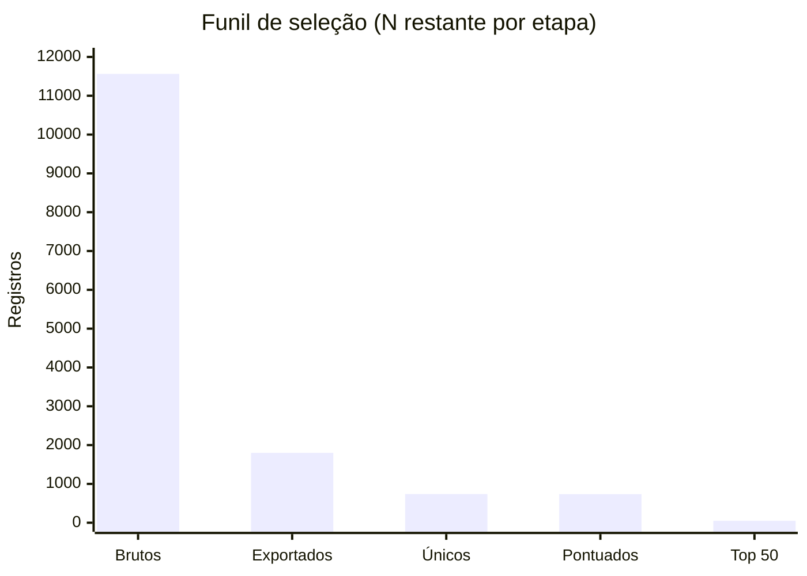

### 12.7 Perfil quantitativo da base completa (N = 740)

#### Distribuição por ano de publicação

|Ano|N|%|
|:-:|:-:|:-:|
|2020|71|9,6%|
|2021|98|13,2%|
|2022|113|15,3%|
|2023|115|15,5%|
|**2024**|**151**|**20,4%**|
|2025|121|16,4%|
|2026|90|12,2%|
|**Total declarado**|**740**|**100,0%**|

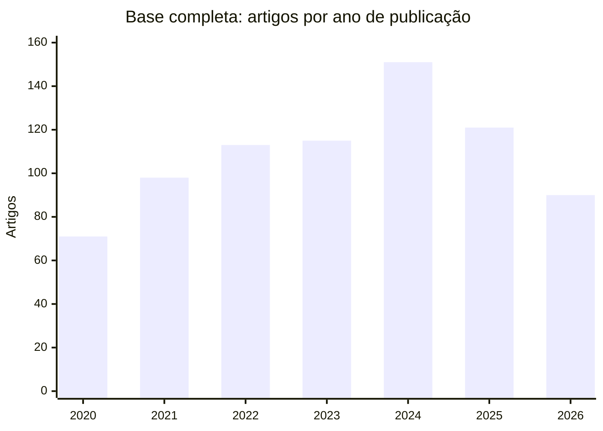

> [!warning] Verificar antes da entrega A soma das contagens por ano é **759** (71+98+113+115+151+121+90), não 740, e os percentuais da tabela (calculados sobre 740) somam 102,6%. O mesmo ocorre na tabela de tipo de publicação (675 + 84 = 759; pelos 91,2% e 8,8%, o número de conferências seria 65). Os valores foram mantidos exatamente como reportados; a tabela de páginas (seção abaixo) soma 740 corretamente.

#### Tipo de publicação

|Tipo|N|%|
|:--|:-:|:-:|
|Periódico (Journal)|675|91,2%|
|Conferência (Conference)|84|8,8%|

#### Distribuição por extensão (páginas)

|Faixa de páginas|N|%|
|:--|:-:|:-:|
|0–4 págs (excluídos por CE3)|3|0,4%|
|5–8 págs|87|11,8%|
|9–12 págs|114|15,4%|
|**13–16 págs**|**261**|**35,3%**|
|**17+ págs**|**145**|**19,6%**|
|Não informado|130|17,5%|
|**Total**|**740**|**100,0%**|

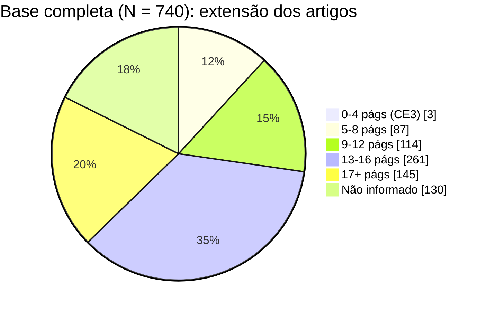

#### Top 5 artigos mais citados (base completa)

|#|Título (resumido)|Citações|Ano|
|:-:|:--|:-:|:-:|
|1|Multi-Agent DRL-Based Trajectory...|546|2021|
|2|Multi-Agent DRL for Task Offloading in MEC|525|2022|
|3|Collaborative Multi-Robot Search and Rescue|516|2020|
|4|Comm. and Control in Collaborative UAVs|385|2020|
|5|Multi-UAV-Enabled Load-Balance MEC|371|2021|

### 12.8 Perfil quantitativo do Top 50 (N = 50)

#### Distribuição por ano de publicação

|Ano|N|%|
|:-:|:-:|:-:|
|2020–2021|0|0,0%|
|2022|1|2,0%|
|2023|2|4,0%|
|**2024**|**16**|**32,0%**|
|**2025**|**11**|**22,0%**|
|**2026**|**20**|**40,0%**|
|**Total**|**50**|**100,0%**|

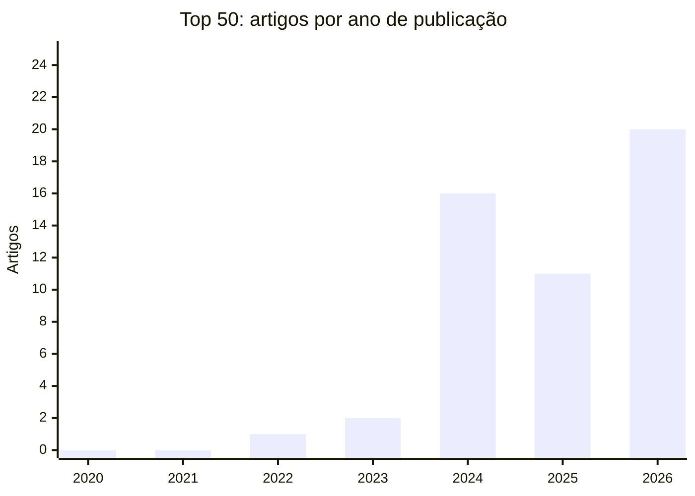

#### Tipo de publicação

|Tipo|N|%|
|:--|:-:|:-:|
|Periódico (Journal)|50|100,0%|
|Conferência (Conference)|0|0,0%|

#### Top 5 periódicos (Top 50)

|Periódico|N|% dos 50|
|:--|:-:|:-:|
|IEEE Transactions on Mobile Computing|5|10%|
|IEEE Transactions on Wireless Communications|5|10%|
|IEEE Internet of Things Journal|5|10%|
|IEEE Access|4|8%|
|IEEE Trans. Intelligent Transportation Systems|2|4%|
|**Total dos 5 principais**|**21**|**42%**|

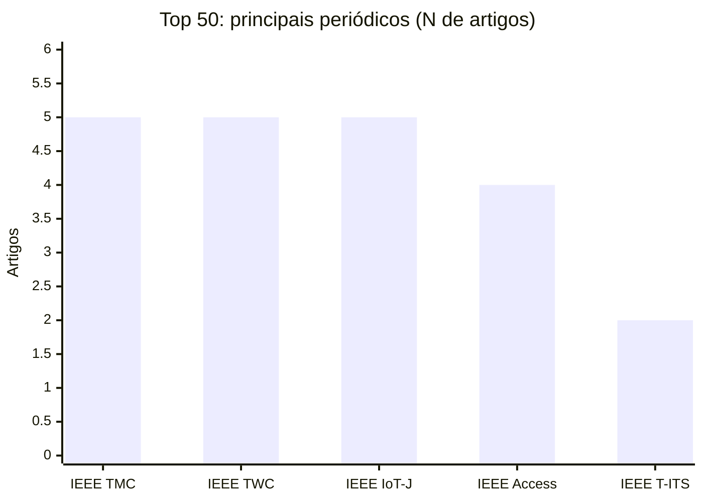

#### Top 5 artigos mais citados (Top 50)

|#|Título (resumido)|Citações|Ano|
|:-:|:--|:-:|:-:|
|1|Multi-Agent DRL for Task Offloading in MEC|525|2022|
|2|Joint Offloading, Res. Alloc. & Trajectory|249|2024|
|3|Multi-UAV Cooperative Task Offloading|249|2024|
|4|Swarm-SLAM: Sparse Decentralized SLAM|176|2024|
|5|DRL-Based Resource Allocation in MEC|173|2023|

### 12.9 Síntese comparativa: base completa (N = 740) vs. Top 50 (N = 50)

|Dimensão / Métrica|Base (740)|%|Top 50|%|
|:--|:-:|:-:|:-:|:-:|
|Ano 2020–2023|397|53,6%|3|6,0%|
|**Ano 2024–2026**|**362**|**46,4%**|**47**|**94,0%**|
|Artigos de periódico|675|91,2%|50|100,0%|
|Artigos de conferência|84|8,8%|0|0,0%|
|Curtos (< 4 págs)|3|0,4%|0|0,0%|
|Médios (5–12 págs)|201|27,2%|5|10,0%|
|**Longos (≥ 13 págs)**|**406**|**54,9%**|**34**|**68,0%**|
|Páginas não informadas|130|17,5%|11|22,0%|

**Indicadores-chave do Top 50**

|Indicador|Valor|
|:--|:-:|
|Estudos publicados em 2024–2026|**94%**|
|Artigos de periódico|**100%**|
|Artigos longos (≥ 13 págs)|**68%**|
|Artigos curtos (< 4 págs)|**0**|

**Melhorias estruturais obtidas pela filtragem**

- **Foco no estado da arte:** 94% dos estudos estão na janela 2024–2026 (40% apenas em 2026), o que dá um mapeamento atualizado do Continuum Físico-Cibernético.
- **Piso de qualidade:** 100% de artigos de periódico, com predomínio de IEEE Transactions e revistas de referência.
- **Conformidade com CE3 e profundidade:** nenhum artigo curto; 68% são de formato longo (≥ 13 págs), o que favorece especificações completas de arquitetura e algoritmos.

**Comparação por período (base completa vs. Top 50)**

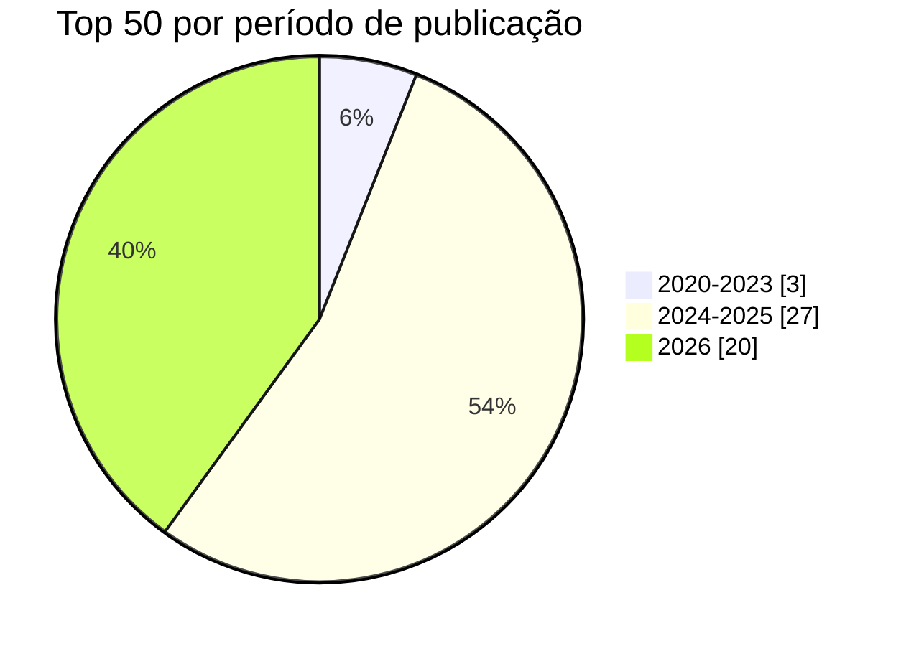

> O ranking pondera 35% de recência, o que explica a concentração em 2024–2026. Esse é um viés deliberado de seleção (a contrapartida do viés de citação da seção 12.4) e deve ser declarado como limitação: estudos clássicos e muito citados de 2020–2021 não aparecem na amostra aprofundada.

---

## 13. Etapa 5 — Triagem e Elegibilidade (Fluxo PRISMA 2020)

### Identificação e Triagem

|Etapa|N|
|:--|:-:|
|Registros identificados (3 bases com contagem: Scopus, IEEE Xplore, WoS)|11563|
|Registros exportados (200 mais citados por string e base)|≈ 1800|
|Duplicatas removidas (Zotero + Rayyan)|≈ 1060|
|Registros únicos selecionados para triagem|740|
|Excluídos por CE3 (< 4 págs)|3|
|Triados e pontuados (TF-IDF 45% + Recência 35% + Cit/ano 20%)|737|
|Não selecionados pelo ranking (abaixo do teto de 50)|687|

### Elegibilidade e Inclusão

|Etapa|N|
|:--|:-:|
|Textos completos avaliados|- (pendente)|
|Excluídos (CE1 a CE5)|- (pendente)|
|Incluídos via snowballing (opcional)|-|
|Limite de inclusão|50 estudos (protocolo original: 40)|
|Selecionados para síntese aprofundada (Top 50)|50|
|Estudos incluídos na síntese|- (após leitura completa)|

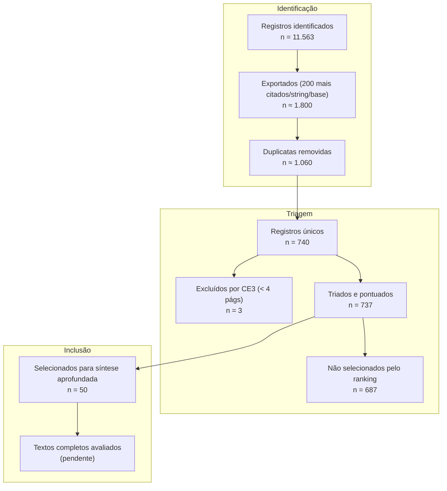

---

## 14. Etapa 6 — Avaliação de Qualidade dos Estudos (QA, versão simplificada)

**Escala:** 1 = Sim, 0 = Não (sem meio-termo, para a avaliação ser rápida). A avaliação é feita por um único revisor, durante a leitura completa, junto com a extração.

|Item|Pergunta|
|:--|:--|
|**QA1 (Clareza)**|A arquitetura, o protocolo ou o método estão descritos de forma clara?|
|**QA2 (Validação)**|Há validação por simulação, HIL ou experimento real?|
|**QA3 (Limitações)**|O artigo discute limitações ou o impacto de falhas e degradação de rede?|

### Uso do Score de Qualidade

A nota final é a **Soma QA (de 0 a 3)**.

- É apenas **descritiva**: a nota é registrada na matriz de extração e **não exclui estudos**.
- Na síntese, os estudos com nota 3 recebem mais destaque na construção das Arquiteturas de Referência, e os de nota 0 ou 1 são citados com ressalva.
- Fica fora de escopo uma avaliação formal de risco de viés, por ser um mapeamento amplo e uma atividade de disciplina. Essa limitação é declarada no relatório (seção 5.2).

---

## 15. Etapa 7 — Matriz de Extração e Ficha de Taxonomia

### Campos Extraídos (Frota & Comunicação)

- **Metadados:** Autor, Ano, Veículo, Base.
- **Frota Robótica:** Tipos (UAV/UGV/USV), heterogeneidade, tamanho da frota, algoritmo de coordenação.
- **Comunicação & Redes:** Modo (explícito/implícito), topologia, middleware (ROS 2, DDS, Zenoh), requisitos e métricas de QoS.

### Campos Extraídos (Integração Físico-Cibernética)

- **Continuum & Infraestrutura:** Camadas (Robô, Edge, Fog, Cloud), offloading, taxa de atualização.
- **Gêmeos Digitais & HIL:** Uso de Digital Twins, co-simulação e sincronização temporal.
- **Validação e QA:** Tipo de validação, limitações e Pontuação QA1–QA3 (0 a 3).

### 15.1 Matriz de distribuição nas dimensões da taxonomia (Top 50) — a preencher

Modelo a ser preenchido durante a leitura completa e a síntese qualitativa dos 50 artigos selecionados no Zotero.

|Dimensão|Categoria taxonômica / Sub-ramo|Contagem (N)|%|
|:--|:--|:-:|:-:|
|**Escopo**|Tarefas / Movimento / Recursos|–|–|
|**Estrutura de decisão**|Centralizada / Descentralizada / Hierárquica|–|–|
|**Método de decisão**|Otimização / Regras e heurísticas / Aprendizado / Negociação|–|–|
|**Processamento**|Robô (onboard) / Edge-Fog / Cloud / Híbrido|–|–|
|**Integração digital**|Digital Model / Digital Shadow / Digital Twin / Nenhum|–|–|
|**Regime temporal**|Online / Offline|–|–|
|**Comunicação**|Explícita vs. Implícita / Infraestrutura vs. Ad-Hoc|–|–|

---

# PARTE III — SAÍDAS E ENCERRAMENTO

## 16. Entregáveis e Arquiteturas de Referência

### Entregáveis da Revisão Sistemática

Relatório Técnico PRISMA (15–20 págs), Taxonomia Hierárquica em 3 Dimensões, Quadro do Ecossistema Tecnológico, Mapeamento de Lacunas e Matriz de Extração Completa.

### Arquitetura 1: Borda-Robô

Foco em controle de tempo real crítico e ultra-baixa latência, inferência local no agente e orquestração regional na Borda (Edge).

### Arquitetura 2: Nuvem-Fog-Robô

Foco em grandes frotas, treinamento centralizado/federado na Nuvem (Cloud), orquestração na camada Fog e execução distribuída.

---

## 17. Checklist de Prontidão Operacional (PRISMA 2020)

### Preparação & Piloto

- [x] Biblioteca Zotero por base configurada.
- [x] Projeto no Rayyan QCRI criado.
- [x] Teste piloto em artigos de referência executado.
- [x] Protocolo congelado antes das buscas oficiais.

### Triagem, Extração & Síntese

- [x] Deduplicação Zotero + Rayyan.
- [x] Leitura integral com registro de motivos CE.
- [x] Extração nos 3 Níveis + Scores QA1–QA3.
- [x] Snowballing de 1º grau (**opcional**, só se sobrar tempo e vaga entre os 40 estudos).

---

## 18. Referências Metodológicas e de Base

_(Conteúdo não detalhado no slide.)_

---

## 19. Obrigado! Perguntas e Considerações

**Saulo José Almeida Silva**  
saulo.jose.silva@ee.ufcg.edu.br